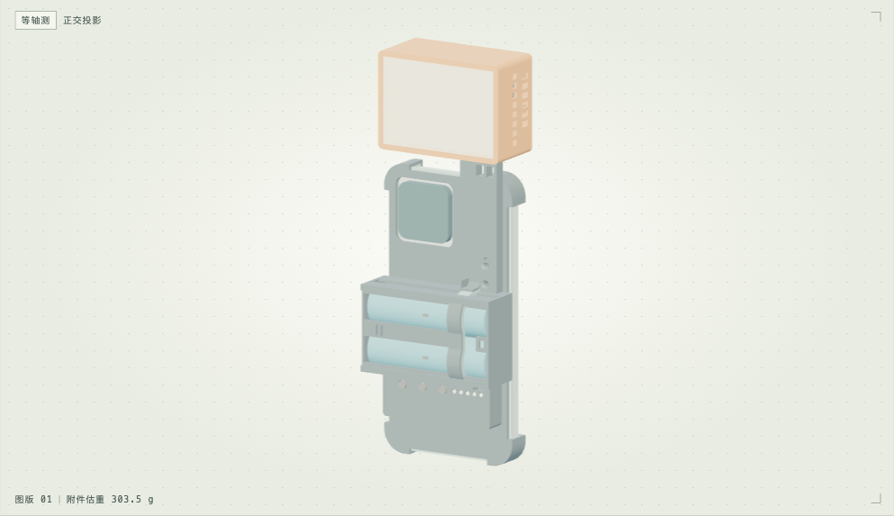

# PCB 设计输入（给画图工程师）

v0.3 · 2026-11-18 · 结构输入第三版（可以开始试排，尚未到投板状态）。三块板的外形、安装孔、接口位置、禁布区与限高以 DXF 为准；电气原理图另行提供，元件封装以原理图为准。

## 1. 先看这些

| 内容 | 位置 |
|---|---|
| 装在手机上的样子：网页三维查看（可旋转、爆炸、剖切、量尺寸） | https://glasses.youngtuo.win/filllight/ |
| 三维效果图 | [等轴测](images/filllight-iso.png)、[背面](images/filllight-back.png)、[侧面](images/filllight-side.png)、[爆炸图](images/filllight-exploded.png) |
| 三块板的 DXF（单位 mm） | [mech/pcb/main.dxf](../mech/pcb/main.dxf)、[driver.dxf](../mech/pcb/driver.dxf)、[led.dxf](../mech/pcb/led.dxf)，每个都有同名 PNG 预览 |
| DXF 图层与每块板的接口表 | [mech/pcb/README.md](../mech/pcb/README.md) |
| 机器可读的接口定义 | [mech/pcb/pcb_interface.json](../mech/pcb/pcb_interface.json) |
| 整机布置图（三块板、电池、线束在整机里的位置） | [mech/pcb/assembly_layout.dxf](../mech/pcb/assembly_layout.dxf) 与 PNG |
| 整机结构 STEP（在 PCB 软件里查三维干涉） | [mech/pcb/enclosure_assembly.step](../mech/pcb/enclosure_assembly.step) |
| 灯珠规格书（负载灯 PDF 手册） | 见第 4 节链接 |

需要 DWG 的话可以把 DXF 用 AutoCAD 或 ODA File Converter 另存，几何不变。

## 2. 三块板概况

| 板 | 外形 | 层数 · 材料 · 板厚 | 在哪 | 主要内容 |
|---|---|---|---|---|
| 主板 | 60 × 21 mm，四角 R1.5；无安装孔，由罩内底脚与压脚定位 | 4 层 · FR-4 · 1.0 mm | 手机背面、电池仓下方 | 充电与电源路径（BQ25798）、两串电池保护、给手机供电的 USB-C 输出口、USB-C 输入口、主控、三个按键、五个电量灯、电池线与线束接口 |
| 驱动板 | 60 × 22 mm，四角 M2 通孔 Ø2.3（孔心距两边各 2.5 mm） | 4 层（第 2 层完整地平面）· FR-4 · 1.6 mm | 灯头内、散热片上方 | 两路恒流（TPS92692-Q1，暖白、冷白各一路）、风扇 5 V 与调速、85 °C 温控开关接线 |
| 灯板 | 66 × 46 mm，四角 R2，四角 M2.5 通孔 Ø2.8（孔心 u = 5.5 / 60.5，v = 7.8 / 38.2） | 单面 · 铝基 · 1.6 mm | 灯头内、柔光片后面 | 72 颗灯珠、测温电阻、出线焊盘 |

- 主板朝外一面器件限高 8 mm，朝手机一面贴近电池仓底，分区限高见 DXF 的 HEIGHT_LIMIT 图层。
- 驱动板两路功率区各 15.8 × 16 mm，器件工作限高 5.5 mm（净空 5.95 mm）。按最大封装只排得下 26 件中的 19 件；用 7 × 7 mm 功率电感和 3 × 2.5 mm 调光 PMOS 时 26 件都排得下，候选坐标在 pcb_interface.json。
- 灯板螺钉必须用小头螺钉（头径 ≤ Ø4.0 mm，不加垫圈）：灯珠到 Ø4.0 紧固禁圈最小 0.618 mm；普通 Ø5.0 头时只剩 0.118 mm，不行。

### 接口 1 脚坐标（板局部坐标：TOP 面看，板框左下角为原点，单位 mm；外形与朝向以 DXF 为准）

| 板 | 位号 | 接口 | 1 脚坐标 |
|---|---|---|---|
| 主板 | J1 | USB-C 输入口 | (12.65, 5.9) |
| 主板 | J2 | USB-C 输出口（给手机） | (38.65, 5.9) |
| 主板 | J3 | 2 × 2 功率卧座（候选） | (50.2, 11.7) |
| 主板 | J4 | 8 针 1.25 mm 带锁卧座 | (25.025, 9.6) |
| 主板 | J5 | 电芯与测温焊盘（7 线） | (2.5, 19.5) |
| 主板 | TP1 | 调试触点 | (2.725, 4.6) |
| 驱动板 | J1 | 2 × 2 功率座（侧舱向上插） | (53.5, 12.2) |
| 驱动板 | J2 | 8 针 1.25 mm 带锁卧座 | (40.125, 18.5) |
| 驱动板 | J3 | 灯板出线焊盘（6 线） | (12.15, 18.6) |
| 驱动板 | J4 | 风扇 4 针座 | (29.625, 18.4) |
| 驱动板 | J5 | 85 °C 常闭开关引线焊盘 | (2.93, 11.5) |
| 灯板 | J1 | 六根线侧出表贴焊盘 | (38.65, 1.25) |

线束路径：主板 ↔ 驱动板的两对双绞线与 8 芯线从主板罩出来，沿电池仓背面右侧的可拆线束脊（x 约 50–58）上到颈部，再进灯头；电池七线另走独立出口。

## 3. 板间连接（v0.2）

| 连接 | 针数 | 网络（按针序） | 要求 |
|---|---|---|---|
| 主板 ↔ 驱动板 功率 | 2 × 2 | VSYS、VSYS、GND、GND | 每针额定 ≥ 5 A；两对双绞线（每对一根 VSYS、一根 GND） |
| 主板 ↔ 驱动板 信号 | 8 | GND、DIM_W、DIM_C、DRV_EN、DRV_FLT、FAN_PWM、FAN_TACH、NTC_LED | 1.25 mm 带锁（如 JST GH） |
| 驱动板 ↔ 灯板 | 6 | LEDW_P、LEDW_N、LEDC_P、LEDC_N、NTC_LED、NTC_RTN | 灯板侧焊线或小连接器，见 DXF |
| 主板 ↔ 电池 | 7 | C2_P、C2_N、C1_P、C1_N、NTC1、NTC2、NTC_RTN | 每节电芯正负各一根，来自电池仓两端弹片 |
| 驱动板 ↔ 风扇 | 4 | 5V、GND、PWM、TACH | 40 mm 风扇，5 V 由驱动板产生 |

## 4. 负载灯（灯珠）

选用 **Yujileds BC 系列 3030（YJ-BC-3030-G04）**，暖白 2700 K、冷白 6500 K 各 36 颗，共 72 颗。

- 规格书（厂家原文 PDF）：https://cdn.shopify.com/s/files/1/0344/6401/files/P3200017.00-2.2_YJ-BC-3030-G04.pdf
- 厂家商店：https://store.yujiintl.com/collections/all/products/yujileds-cri-95-1w-led-smd-3030-g03 （商店页为同系列 G03；G04 订货以厂家确认为准）

| 参数（TA 25 °C，300 mA） | 值 |
|---|---|
| 封装 | 3030，3.0 × 3.0 mm，焊盘尺寸见规格书“Recommended solder pad layout” |
| 正向电压 | 2.8–3.2 V |
| 光通量 | 2700 K：90–100 lm；6500 K：112–122 lm |
| 显色 | Ra ≥ 95（最小值）；R9 90、TLCI 97（典型值） |
| 发光角 | 120° |
| 热阻（结到焊点） | 15 °C/W |
| 绝对最大 | 功耗 1.35 W，直流 400 mA，脉冲 600 mA，结温 125 °C，焊点 105 °C，反向 5 V |

接法与工作点（每种色温一路恒流）：

| 项目 | 值 |
|---|---|
| 每色 | 6 串 × 6 并，每串串一个均流电阻 |
| 灯串电压 | 约 17–19 V |
| 驱动能力 | 两路都按单路 20 W 设计，最暖、最冷两端都能出满 20 W；整灯总功率由固件封顶 20 W；固件失控、两路全开时由驱动板上的 85 °C 温控开关切断 |
| 20 W 全给一种色温 | 每颗约 0.56 W、185 mA；该色总电流约 1.1 A。功率为额定的 41%，电流为额定的 46% |
| 两色各 10 W | 每颗约 0.28 W、约 93 mA；每色总电流约 0.56 A |
| 驱动板输入 | 单路最坏输入电流约 3.7 A（系统母线 6.0–8.6 V），功率级电感与走线按此设计 |
| 热 | 焊点温度按 ≤ 85 °C 设计（规格书焊点上限 105 °C）；铝基板导热绝缘层建议 ≥ 2 W/(m·K) |

采购：嘉立创没有现货，按寄料贴片准备；国内渠道和交期待确认。

## 5. 坐标与图层约定

- DXF 原点在板框左下角，x 向右、y 向上；每个 DXF 的 NOTES 图层写明该板在整机里的位置与朝向。
- 图层：BOARD_OUTLINE 板框，HOLES 安装孔与孔周禁铜圈，CONNECTORS 连接器（含 1 脚标记与插拔方向），FIXED_PARTS 位置被结构定死的器件，LED_ARRAY 灯珠位置与极性，KEEPOUT_TOP / KEEPOUT_BOTTOM 禁布区，HEIGHT_LIMIT 分区限高，DIMENSIONS 尺寸，NOTES 说明。
- 标“结构定死”的位置不要动；可以挪的范围写在 mech/pcb/README.md。

## 6. 还没定、要和电气侧确认的

- 功率连接器的具体型号与高度：主板朝外限高 8 mm，常见的 Micro-Fit 3.0 竖装座约 10 mm 会超限；结构按卧式、水平插拔留位，插合后高度目标 ≤ 7.5 mm。单路最坏 3.7 A，若要求断一针后仍 ≤ 额定 70%，每针额定至少 5.29 A。
- 驱动板功率级封装：按 7 × 7 mm 电感、3 × 2.5 mm 调光 PMOS 的紧凑组合排；电感饱和电流、损耗和 20 W 温升由电气侧核算。
- 线束实物：仓上沿处线束截面 6.85 × 2.20 mm，要用实际选的功率线与 8 芯线验证截面、载流与弯折。
- 小头螺钉：按头径 ≤ Ø4.0 mm 采购，核对头径公差、锁付扭矩和铝基板受压。
- 原理图与封装：电气原理图在做，器件封装以原理图为准。
- 灯珠国内采购渠道与交期。
