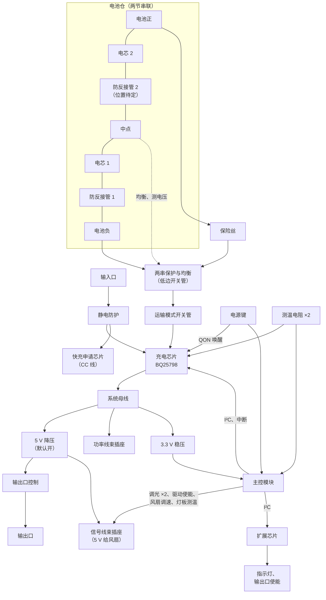
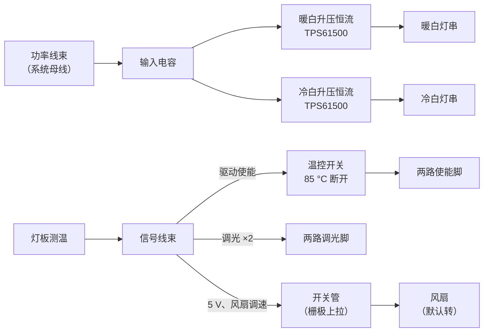

# 硬件架构设计书

**v0.1 · 2026-11-17 · 依据 [规格书](规格书.md) v0.1、[硬件需求](硬件需求.md) v0.1、[系统架构说明书](系统架构说明书.md) v0.1**

本文件说明三块电路板各自做什么、用哪些关键器件、凭什么选、关键数字怎么算出来，以及画原理图和板图时必须遵守的约束。它是 G3（原理图）和 G4（板图）的输入。

## 0 读法

- **证据状态**：每个结论后面都标了状态——“已核实”指设计方读过原厂规格书的对应页；“待核”指只查到存在、还没核参数或库存；“估”指估计值。
- **没有独立复核**：本文件由一个 AI 模型单独写成，还没有安排另一个模型或人独立复核；复核后再冻结。
- **库存**：只核了充电芯片（BQ25798 有货；IP2368 停售或无货，2026-11-17）。立创的匿名搜索查几次后就要求登录，其余器件的库存要登录后再查。
- 数字出自三个脚本：`tools/keepout.py`、`tools/budget.py`、`tools/hw_calc.py`，改假设后可重算。

**读过的资料**

| 资料 | 版本 | 用到的页 |
|---|---|---|
| TI BQ25798 规格书 SLUSDV2C | 2026-06 修订 | 1、5、7、12–14、25–26、29、33、39–40、133、139–140 |
| TI TPS61500 规格书 SLVS893F | 2019-05 修订 | 1、4–6、10–11、13 |
| 英集芯 IP2368 规格书 | V1.41（2023-11） | 1、3、5、10–20、24 |
| 苹果 iPhone 15 Pro 尺寸图 | 2023-10-10 | 全部 3 张 |
| 苹果《配件设计指南》 | R32 Update 1（2026-10-30） | 18、27–28、32、39–40 |

## 1 板级划分

| 板 | 位置 | 尺寸约 | 层数与板材 | 贴装 | 主要内容 |
|---|---|---|---|---|---|
| 主板 | 电池仓下方（离顶边 104–126 mm） | 60 × 21 mm | 4 层，厚 1.0 mm | 双面贴 | 电池保护、充电与电源路径、5 V 输出、主控、按键和指示灯、两个 USB-C |
| 驱动板 | 灯头内，散热片上方 | 60 × 22 mm | 2 层，厚 1.6 mm | 单面贴 | 两路升压恒流、风扇开关、过温切断接线 |
| 灯板 | 灯头内，贴在散热片上 | 66 × 46 mm | 单层铝基，厚 1.6 mm | 单面贴 | 72 颗灯珠、均流电阻、测温电阻 |

主板面积很紧：粗算器件占位约 1100 mm²，板子单面只有约 1260 mm²，所以按双面贴做，G3 开始前先做一次器件占位核算；放不下就沿侧边加长，但不能进入离顶边 126 mm 以下的禁金属带。

## 2 框图

**主板**

**驱动板**

**灯板**

- 暖白：6 路并联，每路 = 均流电阻 + 6 颗串。
- 冷白：6 路并联，每路 = 均流电阻 + 6 颗串。
- 两色交错排布，中部一颗测温电阻。

## 3 关键器件

| 功能 | 首选 | 依据 | 库存与好买程度 | 状态 |
|---|---|---|---|---|
| 充电与电源路径 | TI BQ25798RQMR | 1–4 节、5 A、升降压、内含四个开关管和电池开关；输入 3.6–24 V；自带电源路径；默认值由一颗电阻设定（第 1、25 页） | 立创 C2876593：国际站数据库存 7742，立创商城页面显示嘉立创库存 7893（2026-11-17） | 已核实 |
| 快充申请 | 沁恒 CH224K | 向快充源申请固定电压的受电芯片，电阻配置 | 立创有页面（C970725），但页面内容写的是同系列别的型号，要核对 | 待核 |
| 两串保护 | 紘康 HY2120 系列 | 两节保护，逐节过充 4.10–4.50 V、过放 2.00–3.20 V 可选，SOT-23-6 | 立创有多个后缀在售 | 待核：定后缀（过充 4.28 V、过放 2.90 V、0 V 禁充） |
| 均衡 | 单节均衡芯片（HY2213 一类）×2 | 4.20 V 起分流 | — | 待核 |
| 保护开关管 | 双 N 沟道，30 V，每管不超过 10 mΩ | 6 A 时两管共耗约 0.7 W | — | 待选 |
| 防反接管 | N 沟道 ×2，2.5 V 栅压下不超过 6 mΩ | 栅极由本节电芯自己驱动，3.0 V 时也要导通充分 | — | 待选；第二颗的位置待定（4.1 节） |
| 运输模式开关管 | N 沟道 ×1，30 V，不超过 3 mΩ | 由充电芯片 SDRV 脚驱动，关机时切断整个系统；按住电源键（接 QON 脚）约 1 秒恢复（第 5、49–50 页） | — | 待选；接法对照规格书图 7-15 |
| 5 V 降压 | 4 A 级同步降压，输入耐压不低于 17 V（候选 TPS564201） | 输出口 3 A 加风扇 0.12 A，3 A 级不够 | — | 待核 |
| 输出口控制 | Type-C 供电端控制芯片加限流开关（候选 TPS25810 一类） | 检测接入后上电、通告 3 A、限流、防倒灌 | — | 待选 |
| 3.3 V 稳压 | 输入 18 V、静态电流几微安的低压差稳压器（候选 TPS7A26 一类） | 直接取自系统母线，待机不耗电 | — | 待核 |
| 主控 | ESP32-C3-MINI-1 | 带蓝牙的模块，13.2 × 16.6 mm | — | 待核；引脚数刚好用完，见第 7 节 |
| 灯驱动 | TI TPS61500PWPR ×2 | 输入 2.9–18 V；内置 3 A / 40 V 开关；连续电流调光；反馈基准 200 mV（第 1、6 页） | 立创有页面（C71160），库存没核到；TI 官网状态为在产 | 参数已核实，库存待核 |
| 灯珠 | 未定 | 要求 2835、Ra ≥ 95、R9 ≥ 90、暖白和冷白各一种 | 2026-11-17 没在立创查到同时标明这两项且有货的型号；查到的三星 LM281BA+ 规格书是 Ra90 版（只看了标题，没读正文，也没查有没有 Ra95 档） | **未解决** |
| 风扇 | 40 mm、5 V（厚 7 或 10 mm） | 通用件 | 淘宝常见 | 实验 1 定厚度 |
| 散热片 | 铝型材，底面约 60–70 × 45–50 mm，总高 12–15 mm | 通用件 | 淘宝常见 | 实验 1 定型 |
| 温控开关 | 常闭，85 °C（灯头）和 65 °C（电池仓）各一 | 通用件（KSD 系列一类） | 淘宝常见 | 待选 |
| 电芯 | 21700 平头，5000 mAh 级，持续放电不低于 8 A（整机持续不超过 6 A） | 三星 50E 一类（最大持续放电据记忆为 9.8 A，没核规格书） | 淘宝常见 | 需求方自购 |
| 电池触点 | 片式触点，每点不低于 10 A | 接触电阻直接决定电池仓发热 | — | 待选 |

**弃用：英集芯 IP2368**（立项计划里的原首选）

1. 2026-11-17 查立创：两个标准型号（C5203723、C7545631）已停售，带输出功能的 IP2368_I2C_COUT（C5372184）现货为 0。不符合“好买料”。
2. 规格书 V1.41 第 5 页：标准型号只能充电；要对外放电得用带 COUT 的型号。
3. 第 14 页：带 COUT 的型号第一次接上电池后，要先充电激活才能对外放电。电池可更换的产品每换一次电池都会遇到。IP2368 规格书第 5 页另有去掉激活功能的 IP2368_NACT、IP2368_I2C_NACT，但在立创搜 IP2368 只出现上面三个型号。
4. 第 3 页：V1.40 起不再支持 6 节（与本项目无关，只是说明资料变动大）。

## 4 电源设计

### 4.1 电池输入

- 每节电芯的负极串一颗 N 沟道防反接管，栅极接这一节的正极。装对时导通，装反时关断，这一节等于断开。
- 两节串联后过保险丝（8–10 A），再过两串保护电路（低边双开关管），然后经运输模式开关管接到充电芯片（4.2 节）。
- 每节并一颗均衡芯片和分流电阻。
- **待定：第二节的防反接管放在哪。** 它要串在两节电芯之间，而贴片管子只能由工厂贴在板上（需求方不做贴片焊接）。两种做法，G3 前定：
  - 方案一：电池仓里加一块小板，放两颗防反接管和中点触点；主板只接正、中点、负三根线，中点线只走毫安级电流。
  - 方案二：电池线改成每节正负各一根，共四根，两节在主板上串接；四根都走全电流，主板多两个大电流焊盘。
- 通路电阻预算（`tools/budget.py`）：电芯 44、触点 40、防反接管 12、保护管 20、运输模式开关管 3、电池开关 11、保险丝 5，合计约 135 毫欧。**触点占了近三分之一**，所以触点要选片式大电流的，不用小弹簧。

### 4.2 充电与电源路径（BQ25798）

| 项 | 设计值 | 依据 |
|---|---|---|
| 节数与开关频率 | 两节、750 kHz：设定脚接 8.2 kΩ（三节换 13.7 kΩ） | 第 25 页表 7-1 |
| 无主控时的默认值 | 充电 1 A、截止 8.4 V、系统最低电压 7 V | 第 25 页表 7-2 |
| 主控设定 | 充电电流提到 2.5 A；看门狗超时后自动回到默认值 | 第 25–26 页 |
| 电感 | 2.2 µH（750 kHz 只能配 2.2 µH；1.5 MHz 只能配 1 µH） | 第 133 页 |
| 输入 | 5–12 V；芯片允许 3.6–24 V，极限 30 V | 第 1 页 |
| 输入限流 | 限流脚分压设 3.0 A；输入电压调节保护弱电源 | 第 5、12 页 |
| 电池持续放电 | 6 A（1 秒内峰值 10 A）；过流保护门槛约 9 A 以上 | 第 7、12 页 |
| 电池开关电阻 | 典型 11 毫欧 | 第 12 页 |
| 关机与待机 | 外置运输模式开关管由 SDRV 脚驱动：运输模式下切断系统，按住电源键（接 QON 脚）约 1 秒或插上充电器恢复；关断模式下只有插上充电器才恢复。只接电池时芯片自身 17 微安，关断模式 0.5 微安 | 第 1、5、49–50 页 |
| 测温 | 测温电阻接在基准与地之间的分压上；冷门槛 73.3%、热门槛 34.2% | 第 5、13–14 页 |
| 无电池时 | 关闭充电后，系统母线稳定在系统最低电压；开着充电则母线会来回摆 | 第 33 页 |

- **测温分压**：要让 0 °C 和 45 °C 正好落在冷、热两个门槛上。`tools/hw_calc.py` 用 B 值近似算出上拉约 9.1 kΩ、下拉约 192 kΩ。这个结果对热敏电阻的阻值很敏感，G3 要用选定热敏电阻的阻值表重算。
- **快充**：芯片自带的 9 V / 12 V 握手要主控写寄存器才启用（第 29 页），所以另用一颗独立的快充申请芯片去要 12 V，不依赖主控。
- **没用到的功能**：双输入切换、太阳能最大功率跟踪、反向升压输出。对应的引脚按规格书的“不用时”接法处理，G3 逐脚核对。
- **布局**：BQ25798 规格书第 139–140 页有布局要求，G4 的摆位检查要把它们转成可检查的规则。

### 4.3 5 V 输出

- 4 A 级同步降压从系统母线降到 5.1 V，同时给输出口和风扇。使能用上拉默认打开，不受主控控制（风扇“默认转”的前提）；关机时整个系统由运输模式开关管切断，不靠关这颗降压。
- 输出口控制芯片负责检测设备接入、通告 3 A、限流、短路保护和防倒灌。使能由主控给，默认关。
- 输出口的两根数据线不接。

### 4.4 3.3 V

- 低静态电流稳压器直接取自系统母线。主控工作时约 30 毫安，稳压器耗散约 0.15 W；以后开蓝牙时平均约 50 毫安，约 0.25 W。
- 三节电池时压差更大（12.6 V → 3.3 V），耗散约 0.5 W，届时评估换成小降压。

### 4.5 功率预算（`tools/budget.py`，带“估”）

| 工况 | 电池电流 | 能否持续 |
|---|---|---|
| 只开灯 20 W，电池 7.2 V | 3.3 A | 可以 |
| 灯 20 W 加手机 3 A，电池 7.2 V | 5.5 A | 可以，但电池仓发热约 5.4 W，要降额 |
| 灯 20 W 加手机 3 A，电池 6.4 V | 6.2 A | 超过 6 A，固件先关输出口 |
| 灯 10 W 加手机 3 A，电池 7.2 V | 3.9 A | 可以，电池仓发热约 3.3 W |

续航（估）：20 W 约 1.4 小时，10 W 约 2.8 小时。充电（估）：12 V 快充约 2.4 小时，5 V / 3 A 约 3.2 小时。

## 5 灯驱动设计

### 5.1 拓扑与参数

| 项 | 设计值 | 依据 |
|---|---|---|
| 拓扑 | 每色一路升压恒流，共两路 | — |
| 灯串 | 6 颗串，约 18.8 V（含均流电阻和采样电阻压降） | `tools/hw_calc.py` |
| 开关频率 | 600 kHz（频率脚电阻 176 kΩ） | 第 10 页表 2 |
| 电感 | 10 µH，屏蔽型，饱和电流不低于 5 A | 第 4 页（允许 4.7–47 µH）；核算纹波约 0.7–0.8 A |
| 采样电阻 | 约 186 毫欧（满量程 1.08 A），耗散 0.22 W | 反馈基准 200 mV，第 1 页 |
| 过压保护 | 约 25 V（例如上 191 kΩ、下 10 kΩ） | 门槛 1.229 V，第 6 页 |
| 续流二极管 | 肖特基，40 V，不低于 3 A | — |
| 输出电容 | 耐压不低于 35 V | — |
| 调光 | 主控 20–40 kHz 脉宽 → 调光脚电容滤波 → 连续的电流基准 | 第 4、11 页：模拟调光输入频率 200 Hz–40 kHz |
| 使能 | 主控给，经 85 °C 温控开关；芯片内部有 800 kΩ 下拉，线断即关 | 第 10 页 |
| 自身过热保护 | 结温约 160 °C 关断 | 第 6、10 页 |

### 5.2 每路能出多大功率（`tools/hw_calc.py`）

| 母线电压 | 限流取最小值 3 A | 限流取典型值 3.8 A |
|---|---|---|
| 6.0 V | 14.0 W | 18.2 W |
| 6.4 V | 14.9 W | 19.4 W |
| 7.2 V | 16.6 W | 21.7 W |
| 8.4 V | 19.3 W | 25.2 W |
| 10.8 V（三节） | 24.8 W | 32.4 W |

结论：

- 两路同时点亮（中间色温）时合计 20 W 没问题。
- 只点一路（色温调到最暖或最冷）时，保证值约 15 W，电池电压高时能到 19 W。**纯暖白或纯冷白的最大亮度比中间色温低**，这要写进规格。
- 三节电池时单路 20 W 以上有余量。
- 效率 88% 是估计值；占空比约 62–69%，在芯片最大占空比 89% 以内（第 6 页）。

### 5.3 调光的下限

规格书说这种调光是把 200 mV 基准按脉宽比例缩小。亮度很低时基准只有几毫伏，误差会变大，所以需求里只要求“最低不高于 5%，目标 2%”，低端不保证精度。不采用芯片的另一种“纯脉宽调光”，因为它只支持 200 Hz–1 kHz（第 4 页），拍摄会出条纹。

### 5.4 风扇与过温

- 风扇由一颗开关管控制，栅极上拉；风扇的 5 V 取自默认打开的 5 V 降压（4.3 节）。所以主控不工作时风扇转。
- 85 °C 常闭温控开关用螺丝固定在散热片上，串在驱动使能线里。散热片超温时两路同时熄灭，与主控无关。

## 6 灯板设计

- 72 颗 2835：暖白 36、冷白 36，各 6 路并联、每路 6 颗串加一颗均流电阻。
- 排布：12 列 × 6 行，间距约 5.5 × 7.6 mm，两色交错。
- 20 W 全给一色时每颗约 0.56 W；两色各半时每颗约 0.28 W。灯珠要选额定 1 W 级的，降额使用。
- 柔光板离灯珠不小于 8 mm（不小于灯珠间距），避免看到亮点。
- 铝基板单层走线：6 路并联的汇流走线放在板边，支路之间不交叉；G4 先排一版确认单层能走通。
- 中部放一颗 10 kΩ 测温电阻。
- 灯珠是标准 2835 焊盘，第一版用哪家都能换。

## 7 控制与接口

**主控引脚**（`tools/hw_calc.py`）：共需要 22 个，ESP32-C3-MINI-1 可用约 15 个。

| 去向 | 信号 | 数量 |
|---|---|---|
| 留在主控上 | I²C、充电芯片中断、两路调光、驱动使能、风扇调速、三路模拟量（灯板测温、电芯测温、电池中点）、电源键、加减键、调试串口 | 15 |
| 挪到 I²C 扩展芯片 | 五颗指示灯、输出口使能和故障 | 7 |

5 V 降压用上拉默认打开，不占引脚；电源键同时接充电芯片的 QON 脚，用来从运输模式唤醒。这样刚好用完，没有余量。G3 前二选一：加减键改成一个模拟输入（省 1 个）；或换同尺寸、引脚更多的模块（ESP32-C6-MINI-1，待核）。

**电池电压和电流**：电池总电压、电池电流、输入电压电流都从充电芯片的模数转换器读（I²C），主控自己只量电池中点。

**调试口**：6 个焊盘，1.27 mm 间距，放在装好后还能碰到的板边。

## 8 互连

| 线束 | 导线 | 连接器（初定） |
|---|---|---|
| 功率线束（主板 → 驱动板） | 系统母线 ×2、地 ×2，交错排列，每根 0.3 mm² 左右 | 每针额定不低于 5 A 的 4 针；或改成 3 正 3 地的 6 针，断一根后其余每针仍在额定内 |
| 信号线束（主板 → 驱动板） | 5 V、地、调光 ×2、驱动使能、风扇调速、灯板测温 ×2 | 1.0 mm 间距 8 针 |
| 灯板线（驱动板 → 灯板） | 两路灯串正负、测温 ×2 | 焊盘直焊或 6 针插座 |
| 电池线 | 正、中点、负（方案二为四根） | 焊盘直焊，大电流线 0.5 mm² |

功率线束全长约 25 cm，两根并联往返压降约 0.1 V（4 A 时），可以接受。线束经过手机指南针附近：电源线和地线交错并排，让电流产生的磁场尽量互相抵消，并靠颈部左侧走；影响由实验 3 实测。

## 9 热设计

| 位置 | 发热（估） | 设计措施 | 怎么验证 |
|---|---|---|---|
| 灯头 | 20 W 时约 16 W | 散热片加风扇；85 °C 硬件切断 | 实验 1 先用电阻假件测；G8 实测 |
| 灯头，风扇不转 | 10 W 时约 8 W | 粗算散热片约 69 °C，偏高 | 实验 1 定静音档功率 |
| 电池仓 | 只开灯约 1.4 W；灯加手机约 5.4 W | 通风槽；主板铺铜；按电芯温度降额；65 °C 硬件切断 | G8 跑 30 分钟 |

粗算用的热阻（被动 5.5、开风扇 2.0 K/W）和换热系数都是估计值，不能当结论。

**灯头厚度**：柔光板 2 + 柔光距离 8 + 灯板 1.6 + 两侧壳壁约 3 = 14.6 mm，34 mm 里留给散热片加风扇约 19 mm（例如 12 mm 散热片配 7 mm 风扇）。实验 1 只在放得进的组合里选；都不够就把灯头再抬高 3 mm（底边离顶边 15 mm 时允许约 39 mm）。

## 10 给原理图和板图的约束

**设计规则**（嘉立创常规工艺）：线宽和间距不小于 0.15 mm；过孔不小于 0.3 / 0.6 mm；最小封装 0402。

**大电流走线**（`tools/hw_calc.py`，外层、温升 20 K）：6 A 用 1 盎司铜要 2.3 mm 宽。电池线、系统母线、5 V 输出一律用铺铜，不用细线。

**摆位检查要覆盖的器件**（G4 按各自规格书把要求写成规则）：

| 器件 | 规则来源 |
|---|---|
| BQ25798 的输入电容、输出电容、电感、自举电容 | BQ25798 规格书第 139–140 页 |
| TPS61500 的输入电容、电感、二极管、输出电容回路；散热焊盘接地过孔 | 规格书的布局一节，G3 补页码 |
| 5 V 降压的输入电容和电感 | 所选器件规格书 |
| 主控模块天线端的净空 | 模块规格书 |
| 两个 USB-C 的静电防护器件紧靠接口 | — |

**高度分区**：主板朝外一面限高 8 mm，朝手机一面限高按接口表；电感、USB-C、模块都放朝外一面。

**测试点**：每路电源、电池中点、I²C、驱动使能、调光、灯串正负。

**hw/ 生成脚本需要具备的能力**：库名和设计规则可配置、板框圆角和禁布区、电源器件指定坐标并做摆位检查、原理图与板图一致性检查、未连接数为 0 的闸门。

## 11 故障分析

| 故障 | 后果 | 靠什么防 | 残余风险 |
|---|---|---|---|
| 一节电芯装反 | 这一节被反向充电 | 防反接管把它断开 | 结构防呆对平头电芯不可靠，只能靠电路；第二节那颗管子的位置待定（4.1 节） |
| 两节新旧或电量差很多 | 弱的一节先过放或先过充 | 逐节保护切断；均衡慢慢拉平 | 可用容量变小；说明里要求成对使用 |
| 触点接触不良 | 局部发热 | 65 °C 温控开关；固件看电芯温度 | 温控开关离热点远时反应慢 |
| 输出口短路 | 大电流 | 限流开关；降压过流保护 | — |
| 灯串开路 | 输出电压飙升 | 驱动过压保护 | — |
| 灯珠短路一颗 | 那一路电流偏大 | 均流电阻限制偏流 | 那一路寿命缩短 |
| 风扇堵转或线断 | 散热片升到 100 °C 以上 | 85 °C 温控开关；固件 80 °C 降额 | 塑料件在 85 °C 附近的强度要测 |
| 线束信号线断 | 灯不受控 | 使能线断即关 | — |
| 线束功率线断一根 | 另一根过流发热 | 每根导线按全电流选线径；连接器每针不低于 5 A，或用 3 正 3 地 | 连接器选定前，残余风险是剩下的针过载发热 |
| 主控死机 | 状态不更新 | 硬件默认状态安全；看门狗复位 | — |
| 充电器是 5 V 小电流 | 充电器被拉垮 | 输入电压调节自动降流 | — |
| 充电时电芯过热 | 损伤电芯 | 45 °C 硬件停充 | 测温电阻贴合不好时偏差大 |

## 12 装配与上电

**工厂做**：三块板的全部贴片。

**需求方做**：焊电池线（三根，方案二为四根）和测温电阻；插两条线束；装风扇、温控开关、散热片；拧螺丝。

**上电顺序（G7 的检查表按这个写）**

1. 不装电池，用万用表查电池焊盘、系统母线、5 V、3.3 V 对地不短路。
2. 不装电池，输入口接 5 V 充电器：3.3 V 应稳定。没装电池又开着充电时，系统母线会在约 7–8.6 V 之间来回摆（BQ25798 规格书第 33 页），属正常；烧录固件、关掉充电后应稳定在约 7 V。
3. 烧录固件，跑自检。
4. 装一对电量相同的电芯：量电池电压、两节中点电压。
5. 逐项验证保护：反装、充电截止、低电截止、输出口短路。
6. 接驱动板和灯板，从最低亮度开始点灯。
7. 接手机试输出口。

## 13 需求追溯

| 设计章节 | 覆盖的需求 |
|---|---|
| 第 1 节 板级划分 | HW-SYS-02、HW-MEC-02、HW-DFM-01、HW-DFM-03 |
| 第 3 节 关键器件 | HW-SYS-03、HW-DFM-02、HW-DFM-06 |
| 第 4.1 节 电池输入 | HW-BAT-01 至 HW-BAT-08 |
| 第 4.2 节 充电 | HW-CHG-01 至 HW-CHG-10、HW-BAT-10、HW-SYS-06 |
| 第 4.3 节 5 V 输出 | HW-OUT-01 至 HW-OUT-05 |
| 第 4.2、4.4 节（三节兼容） | HW-SYS-05 |
| 第 4.4 节 3.3 V | HW-CTL-07 |
| 第 5 节 灯驱动 | HW-DRV-01 至 HW-DRV-09、HW-OPT-05、HW-OPT-06、HW-THM-04 |
| 第 6 节 灯板 | HW-LED-01 至 HW-LED-05、HW-OPT-02 至 HW-OPT-04、HW-OPT-07 |
| 第 7 节 控制 | HW-CTL-01 至 HW-CTL-06、HW-BAT-09 |
| 第 9 节 热 | HW-THM-01 至 HW-THM-08 |
| 第 10 节 约束 | HW-SAF-03、HW-EMC-04、HW-DFM-04、HW-DFM-05 |
| 第 11 节 故障分析 | HW-SAF-01、HW-SAF-02、HW-SAF-04、HW-SAF-06 |
| 第 12 节 装配与上电 | HW-SAF-05 |
| 结构与手机兼容（在接口表和结构设计里落实） | HW-SYS-01、HW-SYS-04、HW-MEC-01、HW-MEC-03 至 HW-MEC-08、HW-EMC-01 至 HW-EMC-03、HW-EMC-05、HW-OPT-01、HW-OPT-08 |

## 14 电池形态复评

[规格书](规格书.md)第 3 节第 6 项说的事，在这里展开。立项时评估电池形态只比了能量密度、可信度和更换方便，漏了一条：**圆柱电芯是钢壳，会导磁**。

| 方案 | 电量 | 电池仓外形 | 导磁 | 主板放哪 | 评价 |
|---|---|---|---|---|---|
| 两节 21700 横放（基线） | 36–43 Wh | 77 × 46 × 23.4 mm，两侧各宽出手机约 3 mm | 是 | 下方 60 × 21 mm | 电量最多；要先测指南针和防抖 |
| 三节 18650 横放 | 约 38 Wh | 71 × 59 × 20.8 mm，与手机齐平 | 是 | 没有合适的位置 | 不推荐 |
| 两节 18650 横放 | 约 25 Wh | 71 × 40 × 20.8 mm，齐平 | 是 | 下方约 60 × 27 mm，宽裕 | 最稳妥的退路，电量少三成 |
| 两节 21700 竖放（立项计划） | 36–43 Wh | 46 × 82 × 23.4 mm | 是 | 侧边 | 电芯压进底部天线带，不推荐 |
| 软包一万毫安时 | 约 37 Wh | 约 65 × 100 × 13 mm | 否 | 另找 | 不导磁、最薄；更换靠插头，电芯容量常虚标 |

建议：维持两节 21700 横放，但把实验 3（真电芯贴上去测指南针、防抖、信号）排在最前面。测不过再换软包。

## 15 未解决与待核

| 事项 | 现状 | 下一步 |
|---|---|---|
| 灯珠 | 没找到满足 Ra95、R9≥90 且立创有货的 2835 | 需求方登录立创后继续查；或接受 Ra90；或寄料贴片 |
| 各器件库存 | 只核了充电芯片 | 同上 |
| 嘉立创铝基板能否贴片 | 官网确认能做单面铝基板，没查到能否贴片 | 下单前问客服 |
| 快充申请芯片的型号和配置电阻 | 立创页面内容与型号对不上 | G3 前读原厂规格书 |
| 保护、均衡、防反接、输出口控制、5 V 降压、稳压器的具体型号 | 只有选型条件 | G3 前逐颗读规格书 |
| BQ25798 没装电池时的行为 | 规格书说关闭充电后母线稳定 | G7 实测 |
| TPS61500 的布局要求页码、限流最大值 | 没读到 | G3 前补读 |
| 主控引脚 | 刚好用完 | G3 前定方案 |
| 第二节电芯的防反接管放在哪 | 两种方案（4.1 节） | G3 前定 |
| 运输模式开关管的接法 | 只读到文字说明，规格书图 7-15 没对照 | G3 前对照原图 |
| 颈部线束对指南针的影响 | 没测 | 实验 3 用假线束通电测 |
| 灯头厚度：散热片和风扇的组合 | 34 mm 里只留出约 19 mm | 实验 1 定 |
| 镜头右侧三块禁入区的锥角 | 记在本地手机数据里，没纳入核算 | G5 建模时补算 |
| 独立复核 | 没做 | 安排另一个模型或人复核 |

## 修订记录

| 版本 | 日期 | 内容 |
|---|---|---|
| v0.1 | 2026-11-17 | 首版。充电芯片由 IP2368 改为 BQ25798；灯驱动移到灯头；三块板。未做独立复核。 |
