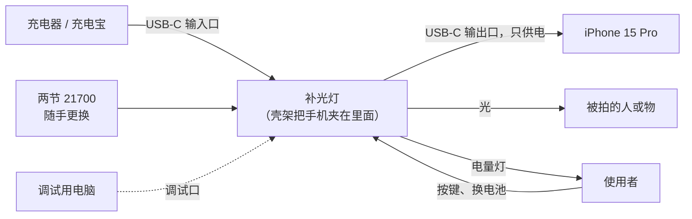
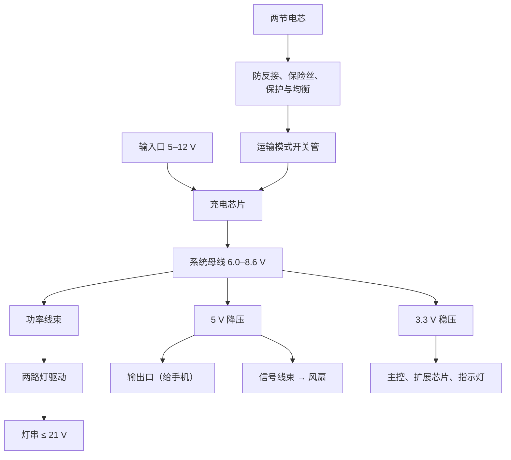

# 系统架构说明书

**v0.1 · 2026-11-17 · 依据 [规格书](规格书.md) v0.1、[硬件需求](硬件需求.md) v0.1**

本文件说明补光灯由哪些部分组成、各部分放在哪里、之间怎么连、各种状态下谁在工作，以及为什么这样分。器件型号和电路细节在 [硬件架构设计书](硬件架构设计书.md)。

## 0 读法

- 文中数值都是设计目标，未实测；带“估”的要由实验替换。
- 本文件由一个 AI 模型单独写成，没有做独立复核。
- 坐标系全项目统一：从手机背面看，原点在左上角；x 向右，y 向下（离顶边的距离），z 为高出背面玻璃的高度。

## 1 系统全景

手机的取景、信号、指南针不能被明显影响，见第 10 节。

| 外部对象 | 和补光灯的关系 |
|---|---|
| 使用者 | 按键调亮度和色温，看电量灯，换电池 |
| iPhone 15 Pro | 被壳架夹住；从输出口取电；它的镜头视野、天线、指南针、防抖不能被明显影响。两者之间没有数据连接 |
| 充电器或充电宝 | 接输入口，给电池充电，同时给灯和手机供电 |
| 电芯 | 两节 21700，使用者自己买、自己换 |
| 调试用的电脑 | 通过调试口烧录固件、看日志 |

## 2 系统组成

| 子系统 | 作用 | 在哪里 | 主要组成 |
|---|---|---|---|
| 发光 | 出光、混色、柔化 | 灯头 | 铝基灯板（暖白和冷白灯珠各 36 颗）、柔光板、遮光檐 |
| 灯驱动 | 把电池电压升到灯串电压，按设定电流驱动 | 灯头里的驱动板 | 两路升压恒流、过压保护 |
| 散热 | 把灯珠和驱动的热带走 | 灯头 | 铝散热片、40 mm 风扇、温控开关 |
| 电池与保护 | 储能；防过充、过放、过流、短路、反装 | 电池仓和主板 | 两节 21700、触点、防反接管、保护芯片、均衡、保险丝、运输模式开关管 |
| 充电与电源路径 | 从输入口取电给电池充电，并给系统母线供电 | 主板 | 充电芯片、快充申请芯片 |
| 手机供电输出 | 给手机 5 V | 主板 | 5 V 降压、输出口控制 |
| 控制 | 读按键和温度电压，设定亮度色温，管风扇和降额 | 主板 | 主控模块和固件 |
| 人机 | 输入和显示 | 主板外露处 | 三个按键、四颗电量灯、一颗状态灯 |
| 结构 | 夹住手机，承载各部分，让开镜头和天线 | 整机 | 壳架、颈部、电池仓、灯头壳，全部打印 |
| 线束 | 把电和信号从主板送到灯头 | 颈部内 | 一条功率线、一条信号线 |

## 3 物理划分

| 部位 | 位置（离顶边 y） | 外形约 | 装什么 |
|---|---|---|---|
| 灯头 | 顶边上方，y 从 −64 到 −12 mm | 宽 72 × 高 52 × 厚 ≤ 34 mm | 柔光板、灯板、散热片、风扇、驱动板、温控开关（厚度预算见规格书第 5 节） |
| 颈部 | y 从 −12 到 57 mm，走镜头平台右侧 | 宽约 22 × 厚约 6 mm | 线束（靠左侧，远离指南针）；承受灯头重量 |
| 电池仓 | y 约 57–103 mm | 宽约 77 × 高 46 × 厚 23.4 mm | 两节电芯横放叠排、触点、两颗测温电阻 |
| 主板区 | y 约 104–126 mm | 板约 60 × 21 mm | 主板、按键、电量灯、两个 USB-C（口朝下） |
| 壳架 | 包住手机四周 | 壁厚约 1.5–2 mm | 各键和接口的开口 |

**为什么这样分**

1. **热**：灯珠和驱动是最大的热源（20 W 时约 16 W 的热），集中在灯头，由风扇带走；电池仓里只留损耗小的电路，不烤电芯。
2. **取景**：左上那颗超广角镜头的禁入锥有 123°。灯头因此要抬高 12 mm，电池仓要从约 57 mm 以下开始。
3. **天线**：手机顶部和底部各有一条禁金属带。电芯横放能让开这两条带；中部的无线充电线圈区被电池仓盖住（因此不支持无线充电）；主板止于 126 mm。
4. **手感**：电池仓在背面中下部，横握时正好当握把。

## 4 接口

### 4.1 对外接口

| 编号 | 接口 | 形式 | 电气或机械特性 |
|---|---|---|---|
| E1 | 输入口 | USB-C 母座，口朝下 | 只进；5–12 V，最大 3 A；接快充源时申请 12 V |
| E2 | 输出口 | USB-C 母座，口朝下 | 只出；5.1 V，最大 3 A；设备接入后才上电 |
| E3 | 电池仓 | 两个电芯位，四个触点，带盖 | 兼容长 69.8–72.5 mm 的 21700；每触点不低于 10 A |
| E4 | 发光窗 | 约 64 × 44 mm，朝后 | 2700–6500 K；20 W 时 0.5 米处不低于 2000 勒克斯 |
| E5 | 手机夹持面 | 打印壳架加软内衬 | 不含金属，不碰屏幕玻璃，各键和接口有开口 |
| E6 | 按键与指示灯 | 三个按键、五颗灯 | 在主板区朝外的一面 |
| E7 | 调试口 | 6 个焊盘 | 3.3 V 串口、复位、下载 |

### 4.2 内部接口

| 编号 | 从哪到哪 | 信号 | 特性 |
|---|---|---|---|
| I1 | 电池仓 → 主板 | 电池正、中点、负；两颗测温电阻 | 电池线持续 6 A；手工焊接。第二节电芯的防反接管若放在主板上，要改成每节正负各一根、共四根大电流线（见硬件架构设计书 4.1 节） |
| I2 | 主板 → 驱动板（功率） | 系统母线 ×2、地 ×2，交错排列 | 6.0–8.6 V（三节时到 12.8 V），最大约 4 A；连接器每针不低于 5 A，或改成 3 正 3 地 |
| I3 | 主板 → 驱动板（信号） | 5 V（给风扇）、地、暖白调光、冷白调光、驱动使能、风扇调速、灯板测温 | 3.3 V 逻辑；调光是 20–40 kHz 脉宽 |
| I4 | 驱动板 → 灯板 | 暖白灯串正负、冷白灯串正负、测温电阻 | 每路最高约 21 V、1.1 A |
| I5 | 驱动板 → 风扇 | 5 V、地 | 约 0.12 A |
| I6 | 驱动板 → 温控开关 | 串在驱动使能线上 | 常闭，85 °C 断开 |
| I7 | 主板内 | I²C | 主控到充电芯片、扩展芯片 |

线束在颈部里走一条通道：穿过手机顶部禁金属带的那一段宽度不超过 8 mm；靠颈部左侧，远离手机指南针。

## 5 电源架构

| 电源 | 电压 | 最大电流 | 从哪来 | 给谁 |
|---|---|---|---|---|
| 输入 | 5–12 V | 3 A | 输入口 | 充电芯片 |
| 电池端 | 6.0–8.4 V | 持续 6 A | 电芯经保护电路 | 充电芯片的电池脚 |
| 系统母线 | 6.0–8.6 V | 持续 6 A | 充电芯片 | 灯驱动、5 V 降压、3.3 V 稳压 |
| 5 V | 5.1 V | 约 3.2 A | 5 V 降压 | 输出口、风扇 |
| 3.3 V | 3.3 V | 0.3 A | 稳压器 | 主控、扩展芯片、指示灯 |
| 灯串 | 17–21 V | 每路 1.1 A | 灯驱动 | 灯板 |

**要点**

- 灯和手机都接在充电芯片的系统母线上，不直接接电池。这样插着电源时由输入优先供电，不够的部分电池自动补上。
- 充电芯片里的电池开关持续只能过 6 A，所以“灯加手机”的总功率有上限：电池单节约 3.3 V 及以下时，20 W 的灯加 3 A 的手机输出会超限，要降额（见第 6 节）。
- 充满且停充时，母线比电池高约 0.2 V（BQ25798 规格书第 39 页），所以系统母线上限是 8.6 V。
- 5 V 降压用上拉默认打开，不受主控控制；关机时由运输模式开关管切断整个系统。
- 两个 USB-C 口方向固定：输入口只进，输出口只出。不存在“手机反过来给灯充电”的情况。

## 6 工作状态

| 状态 | 怎么进入 | 硬件在做什么 | 固件在做什么 |
|---|---|---|---|
| 长期存放 | 出厂，或用组合键进入 | 充电芯片进入关断模式，外置开关管切断系统；只有插上充电器才能唤醒 | 不运行 |
| 关机 | 长按电源键关机 | 充电芯片进入运输模式，外置开关管切断系统；按住电源键约 1 秒恢复供电 | 不运行 |
| 开灯·静音 | 开机且功率不高于静音档 | 驱动按设定电流出光，风扇不转 | 调光、测温、显示电量 |
| 开灯·风扇 | 功率高于静音档，或灯板温度升高 | 风扇转 | 按温度调风扇转速 |
| 充电 | 输入口接上电源 | 充电芯片自主充电，快充申请芯片申请 12 V | 把充电电流提到 2.5 A，电量灯流水 |
| 给手机供电 | 输出口插入手机 | 输出口控制芯片检测到接入后上电 | 监视电流和温度，必要时关断 |
| 降额 | 电流、温度或电量越过门槛 | — | 按下面的阶梯处理 |
| 保护 | 硬件保护动作 | 切断充电、放电或灯驱动 | 记录并提示；固件不参与切断 |

“充电”“给手机供电”可以和“开灯”同时存在。

**降额阶梯（固件做；每一级的最后一道都有硬件兜底）**

| 触发 | 第一步 | 第二步 | 第三步 | 硬件兜底 |
|---|---|---|---|---|
| 电池电流接近 6 A | 关手机输出口 | 降灯的功率 | — | 充电芯片过流保护、保护芯片、保险丝 |
| 电芯温度 | 50 °C：关手机输出口 | 55 °C：灯降到 10 W 以下 | 60 °C：关灯 | 65 °C 温控开关；45 °C 以上不充电 |
| 灯板温度 | 60 °C：开风扇（静音档不开） | 静音档 70 °C、其他档 80 °C：降灯的功率 | — | 散热片上的 85 °C 温控开关切断驱动 |
| 电量低（单节电压） | 3.3 V：电量灯闪 | 3.2 V：关手机输出口 | 3.0 V：关灯并关机 | 2.90 V 保护芯片切断 |

先关手机输出口、后降灯，是因为拍摄中途亮度突变比手机暂停充电更影响使用。这个顺序可以改。

## 7 控制架构

**硬件自主完成、不需要固件的事**

- 充电：默认 1 A、8.40 V；温度不在 0–45 °C 之间时停充；固件失联后回到默认值。
- 电池保护：逐节过充过放、过流、短路、反装。
- 输出口：检测设备接入、限流、短路保护、防倒灌。
- 灯驱动：恒流、灯串开路过压保护、过温切断、使能默认关闭。
- 风扇：5 V 降压默认打开，风扇开关管默认导通，主控不工作时风扇转。
- 关机：充电芯片的运输模式切断整个系统，按住电源键约 1 秒恢复。

**固件负责的事**

| 模块 | 输入 | 输出 |
|---|---|---|
| 按键 | 三个按键 | 开关机、亮度、色温、静音档 |
| 调光与混色 | 亮度、色温设定 | 两路调光脉宽；总功率不超过 20 W |
| 温控 | 灯板测温、电芯测温 | 风扇转速、降额请求 |
| 电池管理 | 每节电压、电池电流（来自充电芯片） | 电量档位、低电处理 |
| 功率预算 | 电池电压和电流、输出口状态 | 降额请求 |
| 充电管理 | 充电芯片状态 | 充电电流设定、喂看门狗 |
| 指示 | 各模块状态 | 五颗灯 |
| 状态管理 | 以上全部 | 第 6 节的状态切换 |
| 存储、看门狗、出厂自检 | — | 记住上次设定；死机自恢复；逐项自检 |
| 蓝牙 | — | 第一版只留骨架，不启用 |

调光是开环的：固件给出电流基准，驱动芯片自己闭环恒流。固件里纯逻辑的部分（调光曲线、状态机、温控、功率预算）可以在电脑上做单元测试。

## 8 安全架构

| 危险 | 第一道（硬件） | 第二道（硬件） | 固件做什么 |
|---|---|---|---|
| 过充 | 充电芯片恒压 8.40 V | 保护芯片逐节 4.28 V 切断 | 监视并提示 |
| 过放 | 保护芯片逐节 2.90 V 切断 | — | 3.0 V 提前关灯 |
| 过流、短路 | 保护芯片 10–15 A | 保险丝；充电芯片过流保护 | 把电流控制在 6 A 以内 |
| 电芯反装 | 每节的防反接管 | 结构防呆（辅助） | — |
| 充电时过冷过热 | 充电芯片按测温电阻停充 | — | 提示 |
| 电芯放电过热 | 65 °C 温控开关切断负载使能 | — | 50 / 55 / 60 °C 三级降额 |
| 灯头过热、风扇失效 | 散热片 85 °C 温控开关切断驱动 | 驱动芯片自身过热关断 | 按灯板温度开风扇、降额（见第 6 节） |
| 灯串开路 | 驱动过压保护 | — | — |
| 固件死机 | 驱动使能默认关、输出口默认关、风扇默认转、充电回默认值 | — | 看门狗复位 |
| 输出口被接上别的电源 | 输出口防倒灌 | — | — |

## 9 热架构

| 热源 | 最大发热（估） | 往哪散 |
|---|---|---|
| 灯珠 | 20 W 时约 13.4 W | 铝基板 → 散热片 → 风扇气流 |
| 两路灯驱动 | 约 2.7 W | 驱动板铺铜 → 灯头内气流 |
| 电芯内阻 | 5.5 A 时约 1.3 W | 电池仓外壳、通风槽 |
| 触点、防反接管、保护管、运输模式开关管、保险丝 | 5.5 A 时约 2.4 W | 主板铺铜、电池仓外壳 |
| 5 V 降压 | 3 A 时约 1.3 W | 主板铺铜 |
| 充电芯片 | 充电时约 1–1.5 W；放电 5.5 A 时内部电池开关约 0.3 W | 主板铺铜 |

灯头的散热能力要由实验 1 确定。电池仓粗算在“灯 20 W 加手机 3 A”时封闭温升约 56 K，所以必须开通风槽并按电芯温度降额。

## 10 与手机的关系

- **取景**：所有部件都在苹果图纸给出的镜头、激光雷达禁入锥之外。手机自带闪光灯的外锥没法让开，所以用本灯时不用手机闪光灯。
- **天线和无线功能**：金属尽量不进顶部和底部的禁金属带，例外是线束穿过顶部那一段，并经过镜头右侧三块禁入区。图纸没写这三块对应哪种天线；苹果《配件设计指南》4.9.5 节提到侵入天线禁入区可能影响 NFC。影响由实验 3 实测。
- **磁**：不用磁铁。钢壳电芯和主板电感都在不放导磁材料的区域内；风扇转子里有小磁铁，放在灯头上部、远离指南针；颈部线束的电流也会在指南针附近产生磁场，所以电源线和地线交错并排、靠颈部左侧。这几项在实验 3 测。
- **背面加厚**：苹果建议背面外壳不超过 2.1 mm（图纸注 8），本灯远超；电池仓还盖住了无线充电线圈区，所以无线充电和 MagSafe 不能用。
- **连接**：手机只通过输出口取电，没有数据往来。

## 11 关键设计决定

| 决定 | 没选的方案 | 理由 |
|---|---|---|
| 两个 USB-C 口，方向固定 | 一个双向口 | 方向确定，不靠协商；充电宝进、手机出可以同时用 |
| 充电用 TI BQ25798 | 英集芯 IP2368 充电宝单芯片 | IP2368 在立创已停售或无货；BQ25798 有货，自带电源路径、默认值安全、资料完整 |
| 灯和手机接在系统母线上 | 直接接电池 | 插电时输入优先供电；没电池也能点灯；电池电流可以从充电芯片读到 |
| 灯驱动放灯头 | 放在电池仓的主板上 | 约 2.7 W 的热离开电芯，交给风扇 |
| 两节串联 | 两节并联 | 用户自己换电芯时，并联的两节电量不同会互相大电流充放；串联加逐节保护更安全，电压也更适合 20 W 的灯 |
| 电芯横放 | 竖放 | 让开镜头禁入区和底部天线带 |
| 连续电流调光 | 低频脉宽调光 | 拍摄时不出条纹 |
| 保护全部由硬件完成 | 部分交给固件 | 固件死机时仍然安全 |
| 灯头抬高 12 mm | 紧贴顶边 | 紧贴时前后只允许约 20 mm 厚，放不下散热片和风扇 |
| 手机输出只做 5 V | 做快充 | 两节电池电压低于 9 V，做快充要再加一级升降压；5 V / 3 A 已够边拍边供电 |

## 12 以后能加什么

- 三节电池：电路板已兼容，换电池仓和保护芯片。
- 手机 App：主控带蓝牙，硬件不用改。
- 相机电池（NP-F）卡口：同样是两节串联的电压，换一个电池仓即可。
- 横拍位置的灯头：需要另一套颈部。

## 13 未决问题

见 [硬件需求](硬件需求.md) 第 15 节。其中影响架构的有五项：钢壳电芯是否保留（实验 3）、颈部线束对指南针的影响（实验 3）、电池仓比手机宽 3 mm 是否接受、第二节电芯的防反接管放在哪、主控引脚是否够用。

## 修订记录

| 版本 | 日期 | 内容 |
|---|---|---|
| v0.1 | 2026-11-17 | 首版。未做独立复核。 |
