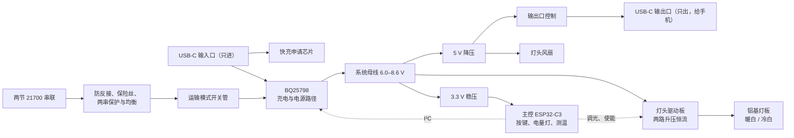

# 15 Pro 机顶补光灯 规格书

- 版本：v0.1（G0 草稿），2026-11-17
- 状态：**待需求方确认**。第 3 节列出了相对立项计划的 7 处修正，第 10 节是需要需求方定的事。
- 配套文件：[硬件需求](硬件需求.md)、[系统架构说明书](系统架构说明书.md)、[硬件架构设计书](硬件架构设计书.md)、[实验与采购清单](实验与采购清单.md)、[机电接口表](../interface/mech_elec.json)

## 1. 目的与成功标准

做一个给 iPhone 15 Pro 定制的补光灯，把“需求 → 选型 → 原理图 → PCB → 结构 → 固件 → 下单 → 装配 → 测试”完整走一遍，用来验证开发流程。

- **产品**：第 4 节的指标实测达标，亮度好于主流口袋补光灯。
- **流程**：每道闸门有记录，最后能说清哪些环节靠得住、哪些要改。

## 2. 已确认的决定

| 项 | 决定 |
|---|---|
| 补光方向 | 朝后，配后置镜头 |
| 灯头位置 | 竖拿手机时在短边上方，像相机的机顶闪光灯 |
| 亮度 | 亮度优先，20 W 双色温；低功率时纯被动无噪声，高功率自动开小风扇 |
| 电池 | 两节 21700 串联，可随手更换；电路板同时兼容三节 |
| USB-C | 能给手机供电；能接充电器或充电宝来充电、供电 |
| 控制 | 三个按键加电量灯；主控带蓝牙，第一版不做 App |
| 外壳 | 全部用拓竹 X2D 打印 |
| 物料 | 要好买：立创 / 嘉立创现货，淘宝常见件 |
| 动手条件 | 有烙铁和万用表：贴片全部交工厂，只焊导线、插件和电池弹片 |

## 3. 相对立项计划的修正

读完苹果官方尺寸图和几份规格书后，立项时的计划里有 7 处要改（[开发计划](开发计划.md) v0.2 已按此更新）：

| # | 计划里写的 | 现在的结论 | 依据 |
|---|---|---|---|
| 1 | 超广角是右侧那颗镜头 | **超广角是左上那颗**，离顶边和左边各 14.17 mm | 苹果尺寸图：左上镜头禁入锥 123°，左下 86°，右侧 33.2° |
| 2 | 灯头紧贴顶边 | **灯头底边要离顶边约 12 mm**（或把下沿削斜），整体厚度不超过约 35 mm | `tools/keepout.py`：紧贴顶边时前后只允许约 20 mm 厚 |
| 3 | 两节电芯竖排在背面下半部 | **电芯改横放、上下叠两节**，电池仓比手机两侧各宽约 3 mm | 竖排会压进底部的禁金属带；横放能让开顶部和底部的禁金属带（中部的无线充电线圈区仍被电池仓盖住，见第 5 节） |
| 4 | 充放电用英集芯 IP2368 | **改用 TI BQ25798**，另加一颗快充申请芯片 | 2026-11-17 查立创：IP2368 两个标准型号已停售，带输出的型号现货为 0；BQ25798（C2876593）有货，国际站数据库存 7742，商城页面显示嘉立创库存 7893 |
| 5 | 两块板，灯驱动在电池仓 | **三块板，灯驱动放进灯头** | 驱动的约 2.7 W 热量放在灯头由风扇带走；放在电池仓会烤电芯 |
| 6 | 评估时只说了圆柱电芯的好处 | **圆柱电芯是钢壳，会导磁**，苹果指南不建议背面放导磁金属；软包没有这个问题 | 苹果尺寸图注 5、注 7。影响主要是指南针，要先实测 |
| 7 | 10 W 以内纯被动 | **纯被动能持续多少瓦还不确定**，粗算 10 W 时散热片约 69 °C，偏烫 | `tools/budget.py`，等实验 1 实测 |

## 4. 指标

| 指标 | 目标 | 怎么测 | 现状 |
|---|---|---|---|
| 中心照度 | 20 W 时 0.5 米处 ≥ 2000 勒克斯；静音档 ≥ 900 | 照度计，暗室，对比一台主流口袋灯（实验 2 先实测它，作为对标值） | 粗算 20 W 约 2390；静音档按 8 W 约 960、按 10 W 约 1195 |
| 色温两端的亮度 | 调到最暖或最冷时只点一路，保证约 15 W（电池电压高时到 19 W），比中间色温暗约四分之一 | 照度计 | 核算见硬件架构设计书 5.2 节 |
| 显色与色温 | Ra ≥ 95、R9 ≥ 90；2700–6500 K 可调 | 按灯珠规格书；没有光谱仪不实测 | 灯珠未选定 |
| 频闪 | 1/8000 秒快门和 240 帧慢动作下无条纹 | 手机拍摄 | — |
| 续航 | 20 W ≥ 1.3 小时；10 W ≥ 2.8 小时 | 实测，两节 5000 mAh | 粗算 1.4 / 2.8 |
| 充电 | 快充（12 V）约 2.5 小时充满；普通 5 V 约 3.5 小时 | USB 功率表计时 | 粗算 2.4 / 3.2 |
| 给手机供电 | 专用输出口 5 V，最大 3 A | USB 功率表 | — |
| 同时带灯和手机 | 电池总电流 ≤ 6 A；接近时先关手机输出口，再降灯的功率 | 实测 | 粗算：单节约 3.3 V 时“灯 20 W 加手机 3 A”已到 6 A |
| 温度 | 塑料表面 ≤ 55 °C；电芯充电 ≤ 45 °C、放电 ≤ 60 °C；散热片可触碰部分 ≤ 60 °C | 测温表，各跑 30 分钟 | 粗算见硬件架构设计书第 9 节 |
| 取景 | 0.5×、1×、3× 都不入镜、不炫光 | 试拍 | 外形已按禁入锥约束 |
| 手机功能 | 指南针、定位、蜂窝、Wi-Fi、防抖对焦、Apple Pay 刷卡无明显变差；不支持无线充电和 MagSafe | 装上前后各测一次 | 有已知偏离和风险，见第 5、8 节 |
| 增重 | ≤ 380 克 | 称重 | 粗算约 343 克 |
| 待机耗电 | 关机 ≤ 100 微安 | 万用表 | 关机时充电芯片进入运输模式，由外置开关管切断整个系统（BQ25798 规格书第 49–50 页）；剩下电池保护电路的几微安 |

## 5. 结构与几何

**坐标系（全项目统一）**：从手机背面看，原点在左上角；x 向右，y 向下（离顶边的距离），z 为高出背面玻璃的高度。手机 70.6 × 146.6 × 8.25 mm（苹果官网规格）。

**三个部分（基线布局，建模时再细化）**

| 部分 | 位置 | 尺寸约 | 说明 |
|---|---|---|---|
| 灯头 | 顶边上方，底边离顶边 12 mm | 宽 72 × 高 52 × 厚 ≤ 34 mm | 从背面到正面依次是：柔光板、灯板、散热片、风扇；驱动板在上部。厚度预算：柔光板 2 + 柔光距离 8 + 灯板 1.6 + 两侧壳壁约 3，留给散热片加风扇约 19 mm（例如 12 + 7）；放不下就把灯头再抬高 3 mm（允许约 39 mm） |
| 壳架与颈部 | 包住手机；颈部走镜头平台右侧 | 颈部宽约 22、厚约 6 mm | 打印件承重；里面走一条扁线束，靠颈部左侧，远离手机指南针 |
| 电池仓 | y 约 57–103 mm | 宽约 77 × 高 46 × 厚 23.4 mm | 两节 21700 横放，上下叠；仓顶跟着电芯圆弧走 |
| 主板区 | y 约 104–126 mm | 板约 60 × 21 mm，厚度区约 10 mm | 按键、电量灯、两个 USB-C（口朝下） |

**硬约束（数字由 `tools/keepout.py` 按苹果图纸算出）**

- 灯头底边离顶边 12 mm 时：背面一侧最多高出背面玻璃 14.2 mm（受超广角禁入锥限制），正面一侧最多高出屏幕 13.1 mm（受环境光传感器限制）。
- 手机自带闪光灯的外锥（157°）没法同时让开。结论：用本灯时不用手机闪光灯，写进说明。
- 电池仓最上面那节电芯的轴线离顶边 ≥ 68.9 mm（受激光雷达禁入区限制）。
- 镜头平台到电池仓之间是矮区：离顶边 50 mm 处最高 9.3 mm，56 mm 处最高 16.4 mm。
- 金属尽量不进苹果图纸划的禁金属区：顶部约 17 mm 宽的一条（两角更深）；镜头平台一带；底部约 126 mm 以下整条（两侧边缘更早开始）；镜头右侧三块禁入区（图纸第 3 张，图上没写对应哪种天线）；背面中部的无线充电线圈区。
- 背面中部一大块（从镜头平台下方到约 113–127 mm）不放磁铁和导磁材料。
- 不遮挡：镜头、激光雷达、背面麦克风、听筒、侧键和操作按钮、底部接口与扬声器。

**绕不开的偏离**

1. **线束**：从电池仓到灯头必须横穿顶部禁金属带，经过镜头右侧的三块禁入区，而且颈部就在手机指南针附近。做法：只走一条窄扁线，电源线和地线交错并排、靠颈部左侧；实验 3 用假线束通电，测指南针和信号。
2. **导磁材料**：钢壳电芯和主板上开关电源的电感都在“不放导磁材料”的区域内。做法：电感全用屏蔽型；先用真电芯贴上去测指南针和防抖（实验 3），不行就改软包。
3. **背面加厚**：苹果建议背面外壳不超过 2.1 mm，以保证全部功能（图纸注 8）。本灯的电池仓、颈部、主板区都远超这个厚度，电池仓还盖住了无线充电线圈区。结果：无线充电和 MagSafe 不能用；Apple Pay 等其他功能由实验 3 实测。

## 6. 电气架构

- 三块板：主板（电池仓下方）、驱动板（灯头里）、灯板（铝基）。
- 两个 USB-C 口方向固定：一个只进（充电器或充电宝），一个只出（给手机），可以同时用，不会搞反方向。
- 灯和手机接在充电芯片的系统母线上：插着电源时，没装电池也能点灯。充满且停充时，母线比电池高约 0.2 V（BQ25798 规格书第 39 页），所以上限是 8.6 V。
- 关机时充电芯片进入运输模式，外置开关管切断整个系统；按住电源键约 1 秒恢复（BQ25798 规格书第 49–50 页）。
- 5 V 降压用上拉默认打开，不受主控控制，所以主控不工作时风扇也有电。
- 兼容三节：充电芯片用一颗电阻选节数；保护芯片要换成三串型号。

**保护全部由硬件完成，不靠固件**

| 保护 | 做法 |
|---|---|
| 逐节过充、过放 | 两串保护芯片逐节监测 |
| 过流、短路 | 保护芯片加保险丝 |
| 反装电池 | 每节电芯串一颗防反接管，结构防呆只作辅助；第二节那颗放在哪还没定（见硬件架构设计书 4.1 节） |
| 充电温度 | 电芯之间的测温电阻接到充电芯片，0–45 °C 之外停充 |
| 灯头过温 | 驱动板上独立的过温切断，固件死机也会关灯 |
| 固件失联 | 充电芯片看门狗超时后回到默认的 1 A、8.4 V |

**按键与指示（第一版）**

- 电源键：长按开关机，短按切换“调亮度 / 调色温”。
- 加、减键：短按一档，长按连续。
- 四颗电量灯；充电时流水；过温或低电时闪烁提示。
- 静音档：同时长按加、减键。功率限制在静音档以内，风扇不转；灯板太热时降功率，不开风扇。

## 7. 固件功能（第一版）

按键、两路调光与色温混合、总功率封顶、温控与风扇、电池管理（逐节电压、低电降档、关断）、灯与手机同时用时的降额、指示灯、记住上次状态、看门狗、出厂自检。蓝牙只留骨架。

## 8. 风险清单

| 风险 | 影响 | 对策 | 在哪道闸门解决 |
|---|---|---|---|
| 钢壳电芯影响指南针或防抖 | 可能要换电池形态 | 实验 3 先测 | G2 |
| 线束和金属灯头影响天线 | 信号变差 | 实验 3 用假散热片和假线束测；灯头抬高 12 mm | G2 |
| 颈部线束的电流干扰指南针 | 指南针随亮度变化偏转，校准消不掉 | 电源线和地线交错并排、线束靠颈部左侧；实验 3 通电实测 | G2 |
| 灯珠没选定（立创上没查到同时标明 Ra95、R9≥90 且有货的 2835） | 显色指标可能降到 Ra90 | 登录立创后逐个查库存；或寄料贴片 | G1 |
| 纯被动档功率偏低 | 静音档可能只有约 8 W | 实验 1 定散热片和档位 | G2 |
| 灯头厚度放不下散热片加风扇 | 要换更薄的组合，或把灯头再抬高 | 实验 1 只在放得进的组合里选 | G2 |
| 嘉立创铝基板能否贴片未确认 | 灯板要换厂 | 下单前问嘉立创客服 | G1 |
| 灯和手机同时满载时电池仓过热（粗算温升约 56 K） | 烫、缩短电芯寿命 | 电池仓开通风槽；按电芯温度自动降额 | G3、G8 |
| 风扇失效时散热片超过 100 °C | 烫伤、打印件变形 | 硬件过温切断 | G3 |
| 风扇里的磁铁离镜头和指南针太近 | 干扰防抖或指南针 | 风扇放灯头最上方；实验 3 测 | G2 |
| 主板面积紧（约 60 × 21 mm，双面贴） | 布不下 | G3 先做器件占位核算，不够就沿侧边加长 | G3 |
| 第二节电芯的防反接管放在哪还没定 | 电池仓要多一块小板，或电池线改成四根 | 两种方案见硬件架构设计书 4.1 节 | G3 |
| 脚本布线布不通电源板 | 流程要改 | 大电流走线和铺铜写进脚本 | G4 |
| 独立复核没做 | 选型里可能有设计方自己没发现的错 | 安排另一个模型或人复核 | G1 |

## 9. 第一版不做

App 和蓝牙功能（硬件留好）、彩色光、无线充电和 MagSafe（电池仓挡住了）、内置插头直连手机、防水、认证、其他机型、横拍位置的灯头、三节电池仓（只做到电路板兼容）、给手机快充（输出口只做 5 V）。

## 10. 需要需求方定的事

1. **电池仓横放、两侧各比手机宽约 3 mm，可以吗？** 不接受的话有两条路：三节 18650 横放（同样电量、和手机一样宽、但主板没地方放）或两节 18650（齐平、轻 46 克，电量少三成）。对照见硬件架构设计书第 14 节。
2. **钢壳电芯的事**：建议先买两节真电芯做实验 3，测完再定是否换软包。
3. **灯珠**：登录立创后可以继续查库存；或者接受先用 Ra90 的三星灯珠出第一版。
4. **实验采购清单**（约 340–535 元）是否照买。
5. 本规格书其余内容是否确认。
